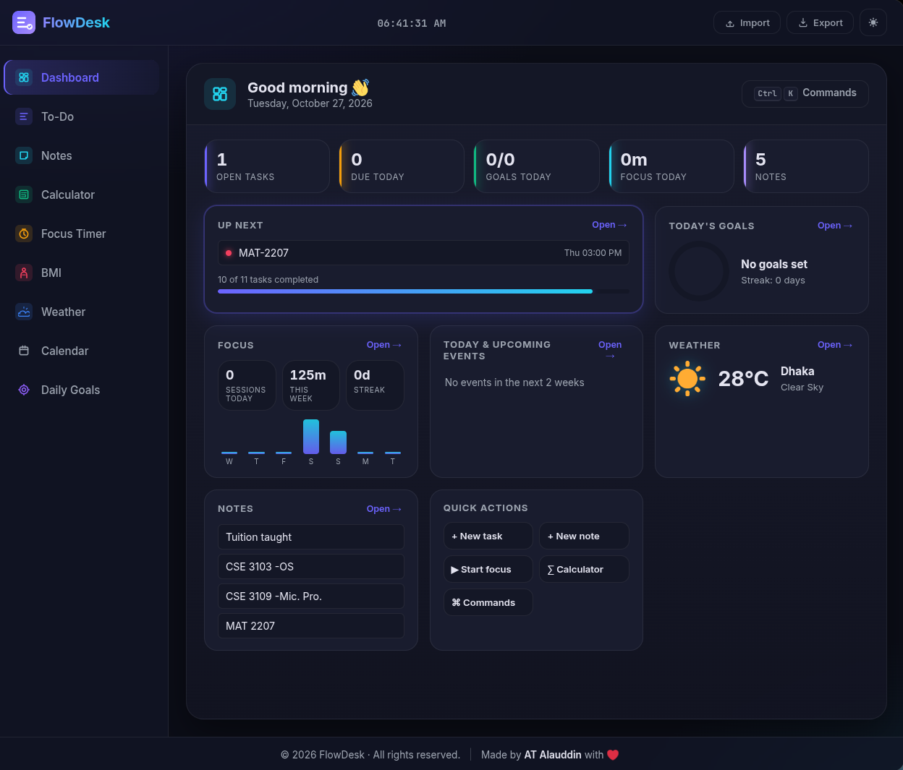
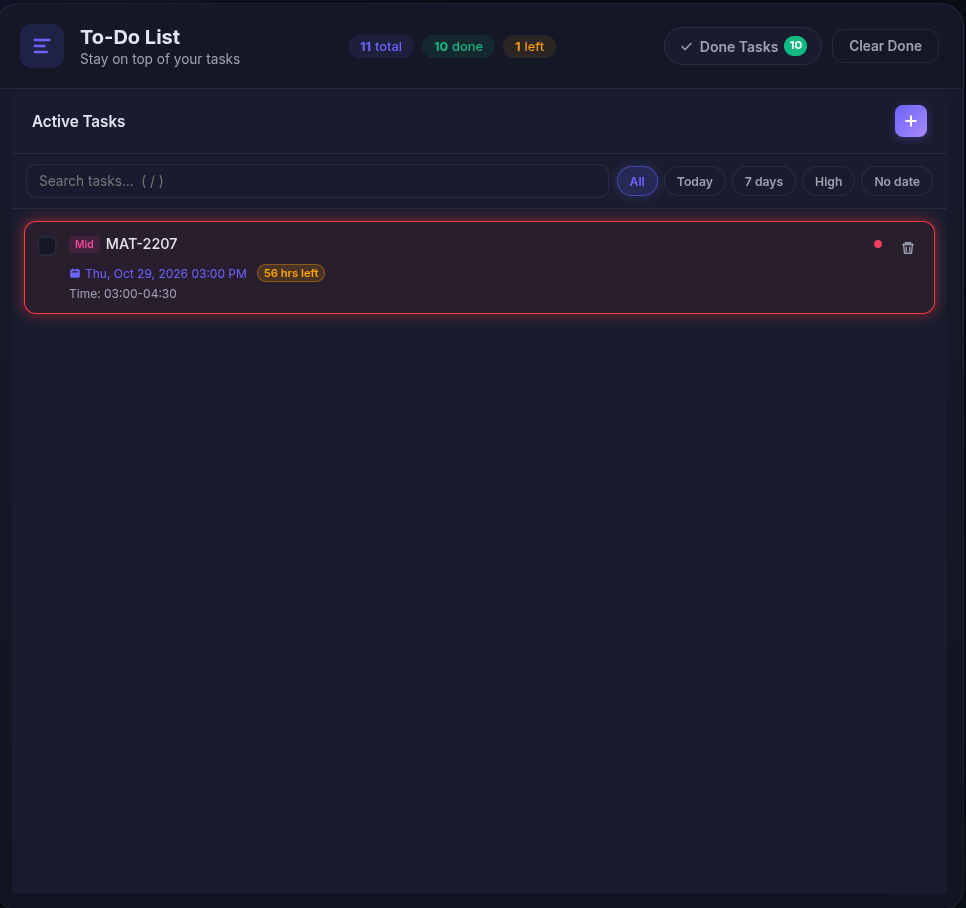
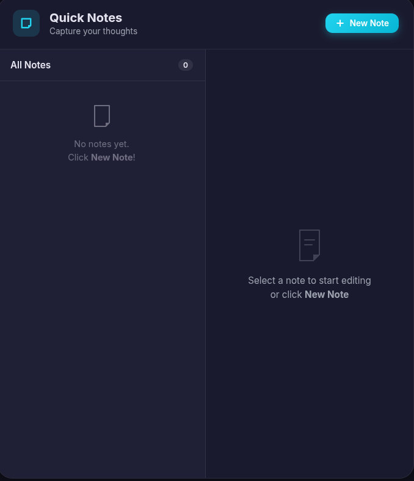
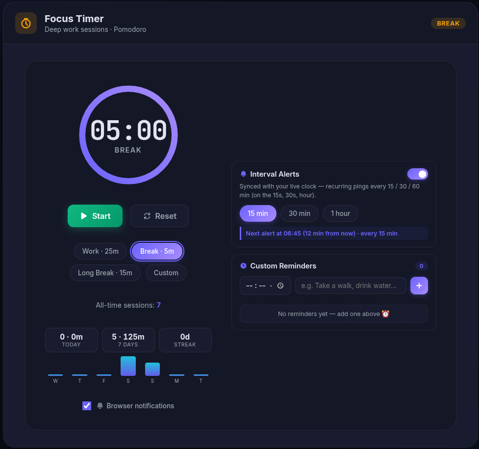
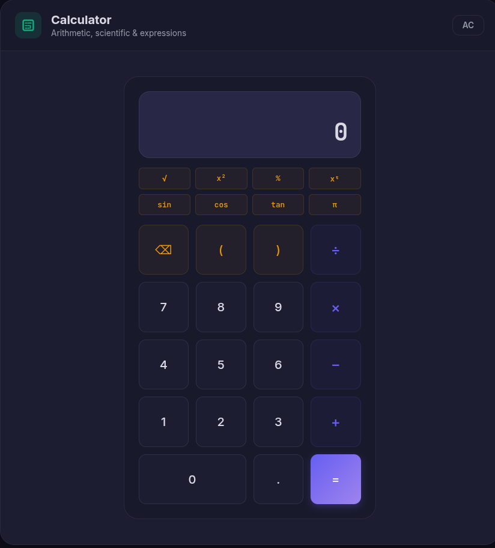
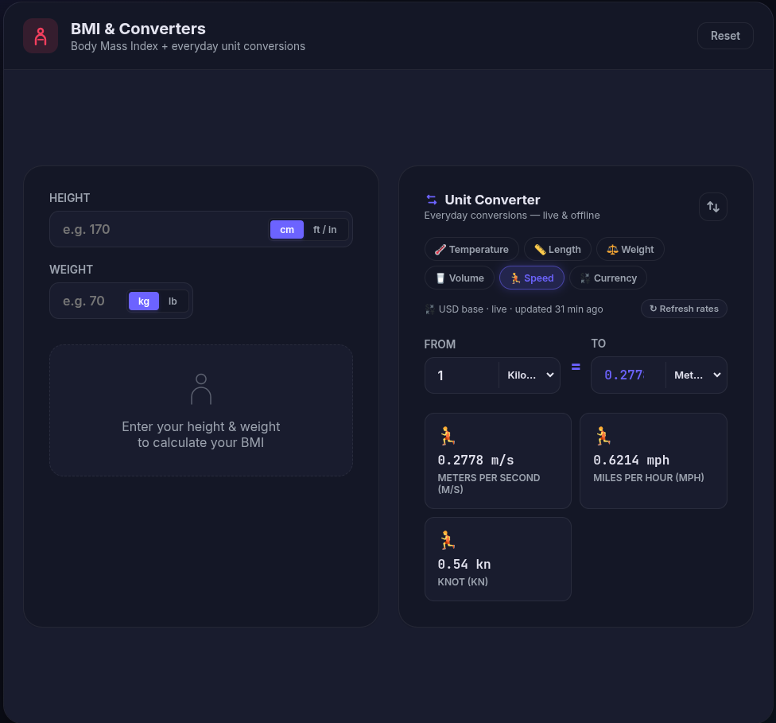
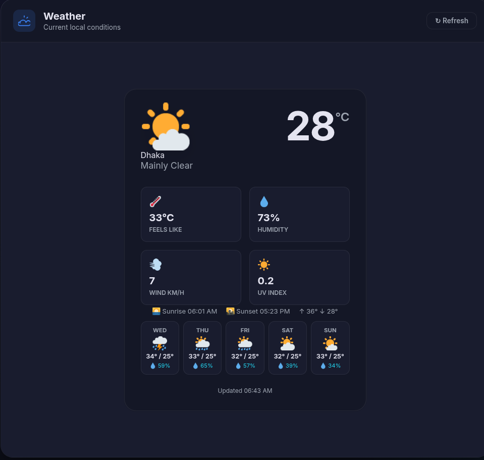
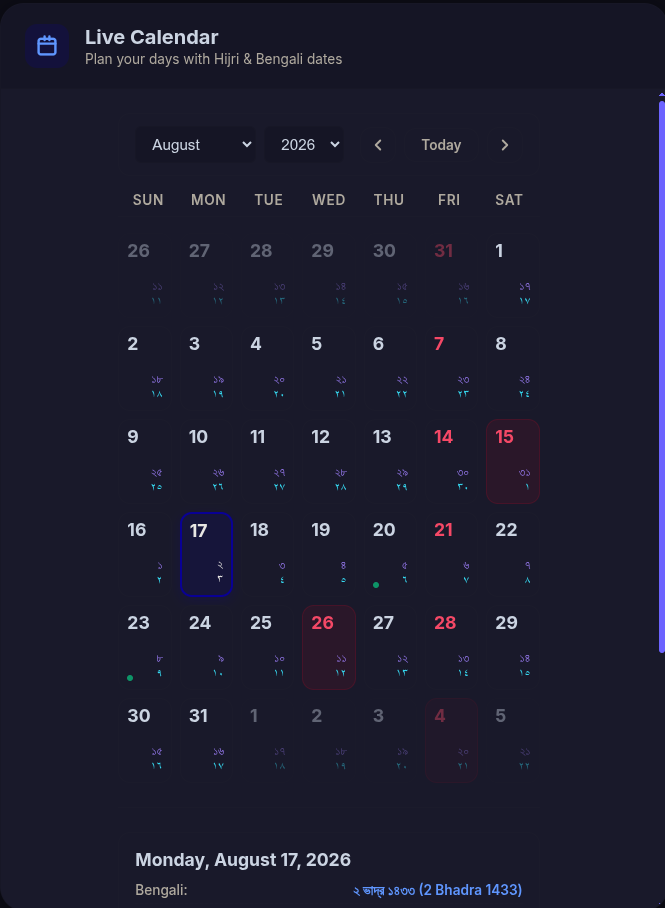
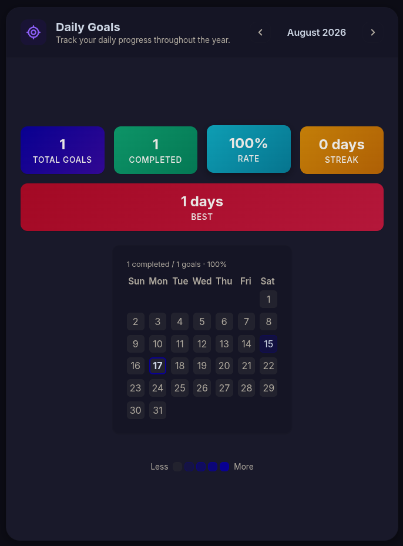

# FlowDesk 🗂️

> A sleek, all-in-one personal productivity dashboard — built with pure HTML, CSS & JavaScript. No frameworks, no dependencies, no server required.


---

## 📸 Website Screenshots & Preview

Here is a tour of the FlowDesk dark & light productivity hub interface across all core widgets:

### 🖥️ Main Dashboard Overview
<p align="center">
  
</p>

### 🛠️ Feature & Widget Showcase

<table width="100%">
  <tr>
    <td width="50%" align="center" valign="top">
      <h4>📝 To-Do Manager</h4>
      
    </td>
    <td width="50%" align="center" valign="top">
      <h4>📌 Quick Notes</h4>
      
    </td>
  </tr>
  <tr>
    <td width="50%" align="center" valign="top">
      <h4>⏱️ Focus Timer</h4>
      
    </td>
    <td width="50%" align="center" valign="top">
      <h4>🧮 Calculator</h4>
      
    </td>
  </tr>
  <tr>
    <td width="50%" align="center" valign="top">
      <h4>⚖️ BMI Calculator</h4>
      
    </td>
    <td width="50%" align="center" valign="top">
      <h4>🌤️ Weather Forecast</h4>
      
    </td>
  </tr>
  <tr>
    <td width="50%" align="center" valign="top">
      <h4>⚖️ Live Calendar</h4>
      
    </td>
    <td width="50%" align="center" valign="top">
      <h4>🌤️ Daily Goals</h4>
      
    </td>
  </tr>
</table>

---

## ✨ Features

| Widget | Description |
|--------|-------------|
| **📝 To-Do List** | Add, complete, and delete tasks. Stats pills show total / done / remaining at a glance. |
| **📌 Quick Notes** | Multi-note rich-text editor. Bold, italic, bullet lists, custom text colour, per-note accent colour. |
| **🧮 Calculator** | Full expression evaluator with backspace, parentheses support, and keyboard input. |
| **⏱️ Focus Timer** | Pomodoro-style countdown (Work 25m / Break 5m / Long Break 15m) with animated SVG progress ring and daily session counter. Plus **live-clock interval alerts** and **custom time reminders** (see [Focus Timer Extras](#️-focus-timer-extras--interval-alerts--custom-reminders)). |
| **⚖️ BMI Calculator** | Easily check body mass index with category indicators — plus a built-in **Daily Unit Converter** (see [Unit Converter](#️-daily-unit-converter)). |
| **🌤️ Weather Forecast** | Check live local weather updates. |
| **⚖️ Live Calendar** | Live calendar in English / Bengali / Hijri — plus **live prayer times** with a next-prayer countdown (see [Prayer Times](#-prayer-times-live)). |
| **🌤️ Daily Goals** | Add your daily goals and track your progress. |

### Extras
- 🌙 / ☀️ **Dark / Light mode** — persisted across sessions
- 🕐 **Live clock** in the navbar
- 📥 **JSON export** of all your todos and notes
- 🍞 **Toast notifications** — no more intrusive `alert()` popups
- ⌨️ **Keyboard support** for the calculator (digits, operators, Enter, Backspace, Escape)
- 💾 **LocalStorage persistence** — everything saves automatically in the browser
- 📱 **Responsive** — single-column stack on small screens

---

## 🚀 Getting Started

No build step needed. Just open `index.html`:

```bash
# Clone the repo
git clone https://github.com/Hi-iamAT/myPro_organizer.git
cd myPro_organizer

# Open directly in your browser
open index.html          # macOS
xdg-open index.html      # Linux
start index.html         # Windows
```

Or serve it locally (optional, for font/network features):

```bash
python3 -m http.server 5500
# Then open http://localhost:5500
```

---

## 🗂️ Project Structure

```
myPro_organizer/
├── index.html              # Main HTML entry point (panels + inline feature logic)
├── style.css               # Design system, tokens, layout & widget styles
├── calc.js                 # fx-991ES-style scientific calculator (safe parser)
├── enhance.js              # v3 dashboard, command palette & shortcut enhancements
├── favicon.svg             # Tab & app branding icon
├── screenshots/            # README UI screenshots
│   └── *.png
└── README.md               # Project documentation
```

---

## 🎨 Design System

FlowDesk uses a **CSS custom property** design token system for effortless theming:

| Token | Light | Dark |
|-------|-------|------|
| `--brand` | `#6C63FF` | `#6C63FF` |
| `--bg` | `#f0f2f8` | `#0f0f1a` |
| `--surface` | `#ffffff` | `#1a1a2e` |
| `--txt` | `#1e1e2e` | `#e4e4f0` |

Fonts: **Inter** (UI) + **JetBrains Mono** (clock, calculator display, timer) via Google Fonts.

---

## 🚀 v3 Highlights

- **Dashboard** (new home): greeting, KPIs (open tasks, due today, goals, focus minutes, notes), up-next tasks, goal ring, focus sparkline, live **next-prayer countdown**, weather snapshot, recent/pinned notes, quick actions.
- **Command palette** — `Ctrl/⌘ + K`; `Alt + 1…9` jumps between tools; `/` searches (To-Do/Notes); `N` new task; `?` shortcut help.
- **To-Do**: live search + filters (All / Today / 7 days / High / No date).
- **Notes**: search titles & content, pin notes to the top.
- **Weather**: 5-day forecast, rain chance, sunrise/sunset, daily high/low.
- **Focus timer**: per-day focus log → today / 7-day / streak stats and a 7-day chart (`flowdesk_focus_log`).
- **BMI**: healthy weight range for your height (kg or lb).
- Export/Import now includes the focus log (optional, so older backups still import).
- **Focus tab extras**: live-clock interval alerts (15/30/60 min) + custom time reminders with your own message, both synced with the live clock, plus a live tab title that shows the next alert / countdown.

## ⚖️ Daily Unit Converter

Lives inside the **BMI & Converters** tab, right under the BMI tool — everyday conversions, live & offline:

| Category | Units |
|----------|-------|
| 🌡️ **Temperature** | °C · °F · K (real formulas, not linear factors) |
| 📏 **Length** | mm · cm · m · km · in · ft · yd · mi |
| ⚖️ **Weight** | g · kg · t · oz · lb · st |
| 🥛 **Volume** | ml · L · fl oz · cup · pt · qt · gal (US) |
| 🏃 **Speed** | km/h · m/s · mph · kn |
| 💱 **Currency** | **Live rates** (USD base) for ~160 currencies via open.er-api.com, Frankfurter/ECB fallback, 1-hour cache, offline-stale support |

- Type a value → **both the To-field and a quick-reference card grid** update instantly (one card per unit of the category)
- **⇄ Swap** button flips "From" and "To" in one click
- Last-used category & units are remembered (`localStorage` key `flowdesk_converter`)

### 💱 Live Currency (wall-clock independent)
- Select the **💱 Currency** chip → any two of ~160 currencies convert using **live exchange rates**
- **Free & keyless**: primary `open.er-api.com`, automatic fallback to `api.frankfurter.app`; rates cached for 1 hour (`flowdesk_currency_rates`) so the panel still works **offline** with slightly stale rates
- Status line shows *"USD base · live · updated 12 min ago"* with a **↻ Refresh rates** button
- Quick-card grid shows popular currencies (EUR, GBP, JPY, INR, PKR, BDT, SAR, AED…) — the entered amount in each at once
- Cross-rates are computed directly (e.g. BDT → INR) with no manual two-step conversion
- Styles reuse the same design tokens as the BMI tool (`.bmi-input-group` pills, `.unit-btn`-grade chips, `.weather-card` quick cards) — dark & light themes included

## 🕌 Prayer Times (live, in the Live Calendar)

Displayed today's schedule in the Live Calendar sidebar — data from the free, keyless **Aladhan API**:

- **Next-prayer hero card** — highlighted card showing the upcoming prayer with a **live 1-second countdown** ("Asr · at 3:24 PM · in 1h 9m") synced to the navbar clock
- **Professional SVG icon set** — stroke-based sun/moon icons in rounded tiles inside the rows, tinted by state (green when ongoing, purple when next, amber for prohibited); the prohibition sign flips to a filled ⛔-style badge while active
- **Full-day schedule (single list)** — one row per window: Fajr · Sunrise · Dhuhr · Asr · Maghrib · Isha, each with its start–end range; the ongoing window gets a green **Now** border/chip and the upcoming prayer a **Next** chip; Isha's window wraps to tomorrow's Fajr (marked ⁺)
- **🚫 Prohibited prayer times** — live sub-list of the day's non-praying windows derived from the actual sun path (Sunrise until the disc fully clears the horizon, Zawal/solar-noon before Dhuhr, and yellowing sun before Maghrib). Window lengths scale with the seasonal day arc, are clamped to sane bounds, and each row turns amber with an **Active** chip while it's happening
- **Hanafi Asr** — the API is queried with `school=1` so Asr uses the shadow-factor ×2 (Hanafi) rule across all calculation methods
- **Calculation method selector** — 13 methods (Karachi default, ISNA, MWL, Umm al-Qura, Egypt, Gulf, Kuwait, Qatar, Singapore, Turkey, Moonsighting, Dubai); persisted choice, cached per-day (`localStorage` keys `flowdesk_prayer_cache`, `flowdesk_prayer_method`, `flowdesk_prayer_coords`) so the panel still works **offline**
- **Location**: reuses browser geolocation with a Dhaka fallback when denied
- Dashboard's calendar card replaced with a **live Next Prayer** widget driven by the same countdown

## ⏰ Focus Timer Extras — Interval Alerts & Custom Reminders

Two clock-synced alerting systems built into the Focus tab:

### ⏱️ Interval Alerts
- Toggle switch in the Focus tab — recurring pings **synced to your live clock** (aligned to wall-clock slots, not offsets): every 15 min → `:00 / :15 / :30 / :45`, every 30 min → `:00 / :30`, hourly → on the hour.
- Chips for **15 min / 30 min / 1 hour**; an always-on banner shows **"Next alert at … (N min from now)"**.
- Each alert delivers a toast + chime + browser notification + flashing tab title. Messages are clock-style: the hour sounds like a clock chime — *"It's 10 o'clock"* — and in-between slots as *"It's 10:15 AM"*.
- Catch-up: if the tab/page slept past a slot, it re-fires on the next alignment instead of skipping.
- State persists across restarts (`localStorage` key `flowdesk_interval_alerts`).

### 🗒 Custom Reminders
- Add a reminder for **a specific time + your own message** (e.g. *10:00 AM — Drink water*).
- List view (sorted by time, AM/PM chips) with a live **"in 2h 15m"** countdown and a **✓ done today** state — fires once per day, re-arms tomorrow.
- The browser notification body shows **your exact custom message**.
- Late catch-up: fired within a 5-minute grace window if the page was closed at the due time.
- Manageable: add / delete anytime; persisted (`localStorage` key `flowdesk_reminders`).

### 🪧 Live tab title
The browser tab always tells you what's happening in the Focus tab:
| State | Tab title |
|-------|-----------|
| Timer running | `(25:11) FlowDesk — Work` (live countdown + mode) |
| Idle, alert scheduled | `⏰ 2:30 PM · 13m — FlowDesk` (nearest upcoming alert or reminder) |
| Idle, nothing scheduled | `FlowDesk — Your Personal Productivity Hub` |

## 🧮 Scientific Calculator

fx-991ES-style calculator (`calc.js`) with a safe recursive-descent parser — no `eval`/`Function`.

- sin/cos/tan + inverses (SHIFT), hyperbolic (HYP), DEG / RAD / GRAD
- x², x³, xʸ, √, ³√, ʸ√x, x⁻¹, log, ln, 10ˣ, eˣ, x!, nPr, nCr, %, Abs, π, e, EXP, Ans
- Memory (M+, M−, MR, MC), two-line display, history (click to reuse), S⇔D fraction toggle
- Implicit multiplication (`2π`, `3(4)`), auto-closing brackets, `Math ERROR` / `Syntax ERROR`
- Keyboard: digits `+ - * / ^ ( ) ! % .`, Enter/=, Backspace, Esc (AC), `s c t` (sin cos tan), `S O T` (inverse), `h` HYP, `l` log, `n` ln, `r` √, `R` ³√, `q` x², `i` x⁻¹, `b` Abs, `p` π, `e` e, `x` EXP, `a` Ans, `m` M, `P`/`C` nPr/nCr, `d` angle mode, `f` S⇔D
- State (angle, Ans, memory, history) stored in `localStorage` key `flowdesk_calc`

## ♿ Accessibility & Polish

- Dark theme is the default (an explicit Light choice is remembered) and applied before first paint — no white flash.
- Visible keyboard focus rings on all controls; brand logo is keyboard-activatable.
- Respects `prefers-reduced-motion`.
- Compact icon-only navbar actions on phones so nothing overflows.

## 🛠️ Tech Stack

- **HTML5** — semantic markup
- **CSS3** — grid layout, custom properties, transitions, SVG animations
- **Vanilla JavaScript** — no external runtime dependencies
- **LocalStorage** — client-side data persistence

---

## 📄 License

MIT © [Hi-iamAT](https://github.com/Hi-iamAT)
